# Seaweed Algebra Manim

Manim animations for visualizing meander winding moves in seaweed algebras.

This package integrates with [`seaweed-algebra`](https://github.com/daflamingfox/seaweed_algebra) to provide smooth [Manim](https://www.manim.community/) animations of each winding move.

## Examples

### Full Wind-Down Sequence

`MeanderElement.wind_down_animation()` continuously computes and executes the next reduction move until the meander becomes the empty meander.

Below, `Meander([17, 3], [10, 4, 6])` winds down across 6 successive moves: Rotation Contraction → Pure Contraction → Component Deletion (4) → Flip → Block Elimination → Component Deletion (3)

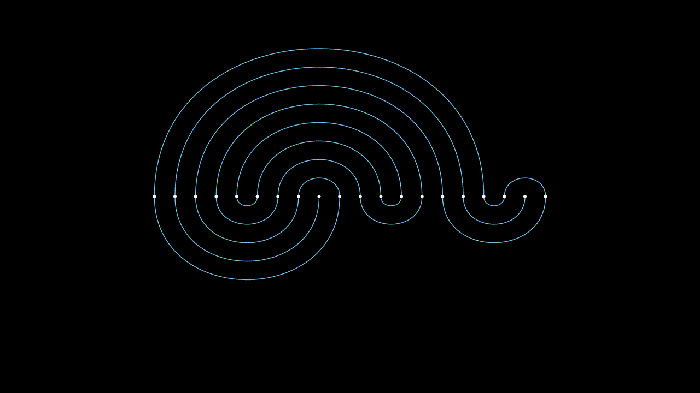

### Single Winding Moves

#### Rotation Contraction

| `Meander([8, 5], [5, 6, 2])` | `Meander([17, 3], [10, 4, 6])` |
| :---: | :---: |
| 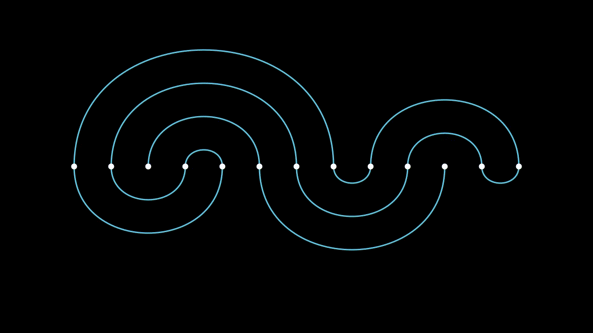 | 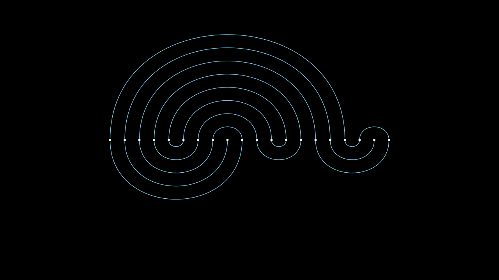 |

#### Pure Contraction

| `Meander([8, 5], [3, 6, 4])` | `Meander([10, 3], [3, 4, 6])` |
| :---: | :---: |
| 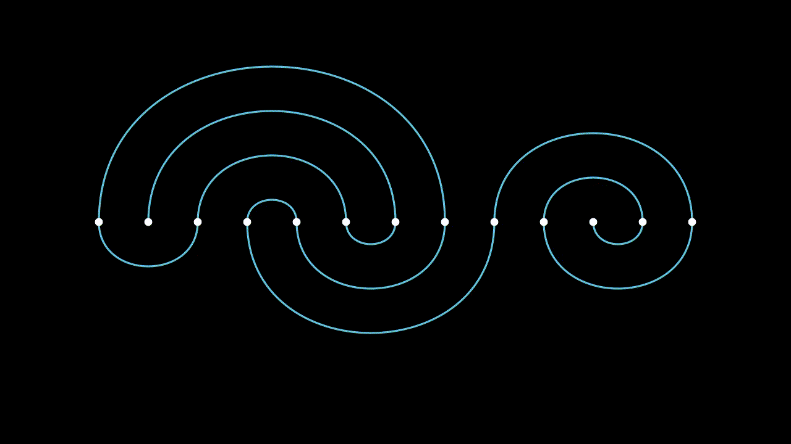 | 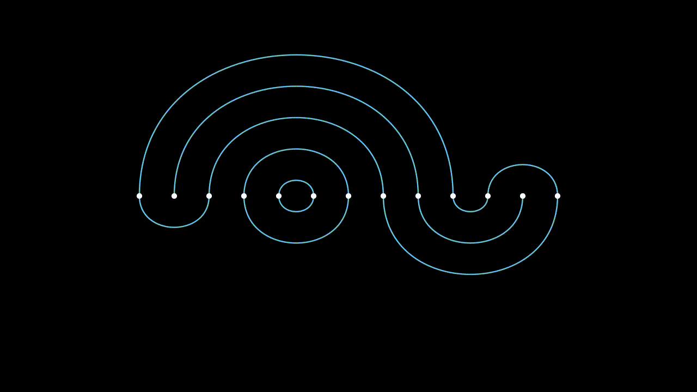 |

#### Component Deletion

| `Meander([8, 5], [8, 2, 3])` | `Meander([4, 3, 3], [4, 6])` |
| :---: | :---: |
| 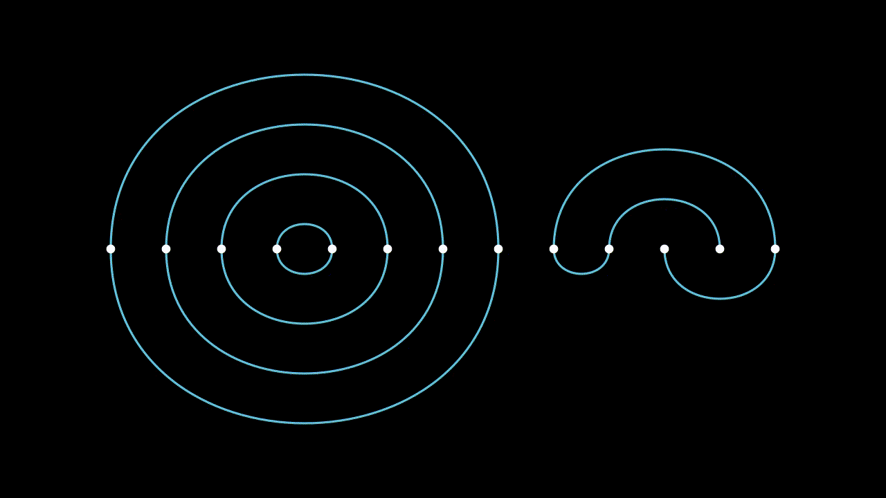 | 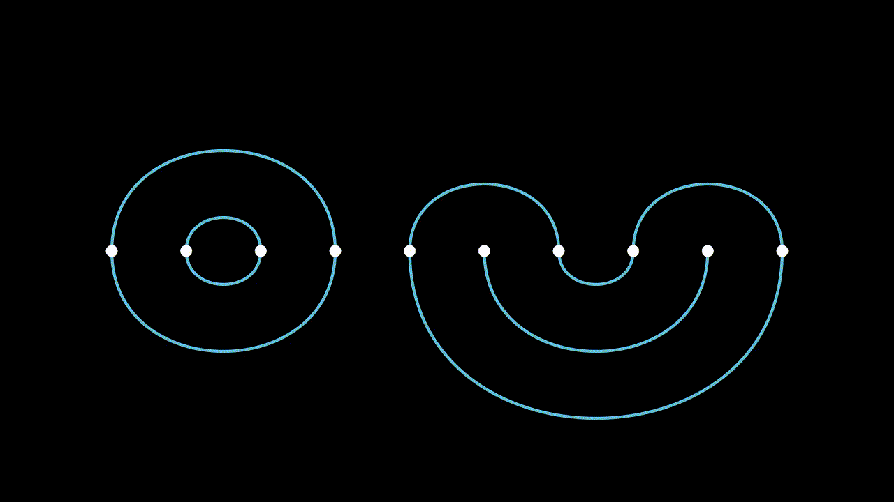 |

#### Flip

| `Meander([8, 5], [10, 3])` | `Meander([3, 3], [6])` |
| :---: | :---: |
| 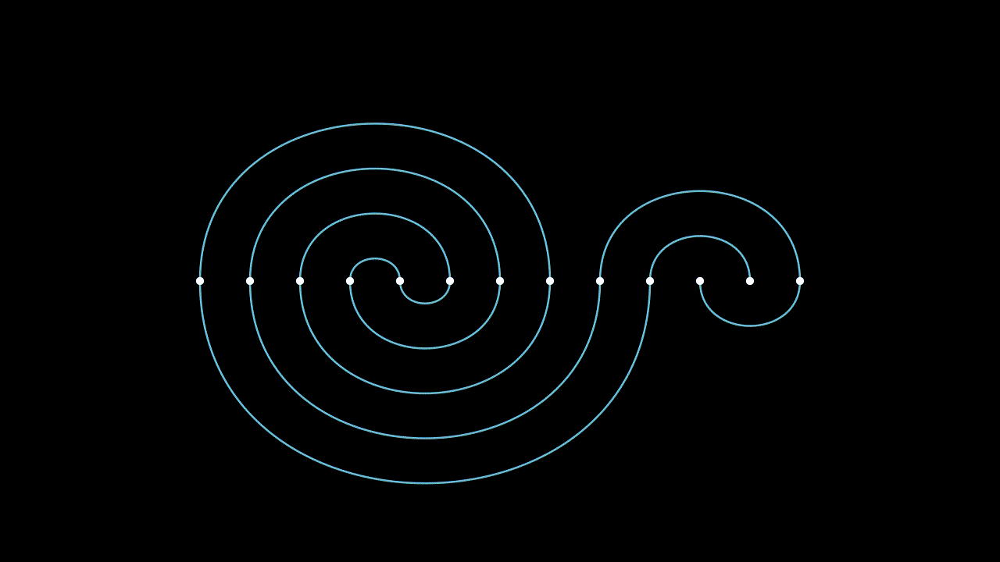 | 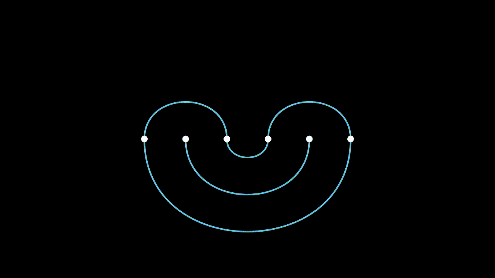 |

#### Block Elimination

| `Meander([8, 5], [4, 6, 3])` | `Meander([6], [3, 3])` |
| :---: | :---: |
| 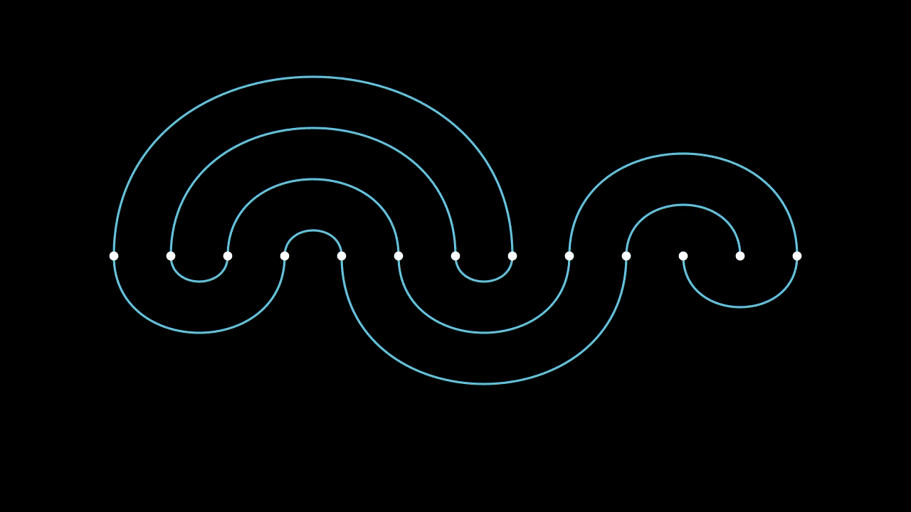 | 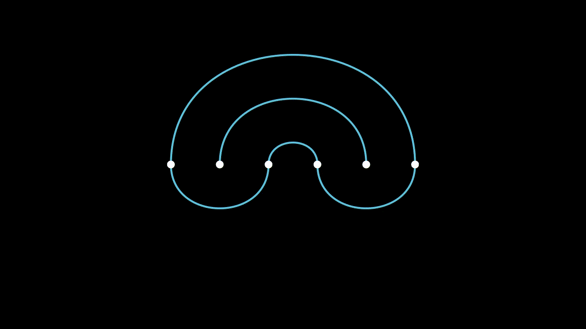 |

## Installation

### Prerequisites

- Python >= 3.12
- [uv](https://docs.astral.sh/uv/) (recommended) or `pip`
- System dependencies for Manim ([more info](https://docs.manim.community/en/stable/installation/uv.html))

### Using `uv`

```bash
git clone https://github.com/daflamingfox/seaweed-algebra-manim.git
cd seaweed-algebra-manim
uv sync
```

### Using `pip`

```bash
git clone https://github.com/daflamingfox/seaweed-algebra-manim.git
cd seaweed-algebra-manim
pip install -e .
```

## Usage

See [`examples/example.ipynb`](./examples/example.ipynb) to see usage examples and to play with the code yourself.

Additionally, there is a script [`render_examples.sh`](./examples/render_examples.sh) which will render all the above examples.

```bash
./examples/render_examples.sh
```

## Architecture

- **`MeanderElement`**: A `VGroup` representing the complete meander configuration (nodes and top/bottom arcs). Provides high-level move animations (`rotation_contraction_animation`, `pure_contraction_animation`, `component_deletion_animation`, `flip_animation`, `block_elimination_animation`), automated step dispatch (`wind_step_animation`, `wind_down_animation`), and camera management (`fit_camera`, `compact_and_fit_camera_animation`).
- **`MeanderArc`**: A `VMobject` cubic Bézier arc that attaches dynamically to two `MeanderNode` instances. Computes control handles based on node tangent angles and automatically recomputes geometry via an updater.
- **`MeanderNode`**: A `Dot` mobject representing an indexed meander node. Maintains internal tangent vectors and uses `move_along_arc` to travel smoothly along a connected Bézier trajectory while smoothly rotating its tangent vector.
- **`MeanderFlip`**: A 3D rotation animation that flips the meander across the horizontal axis with updater suspension.

## License

This project is licensed under the [GPL v3.0](./LICENSE.txt).
